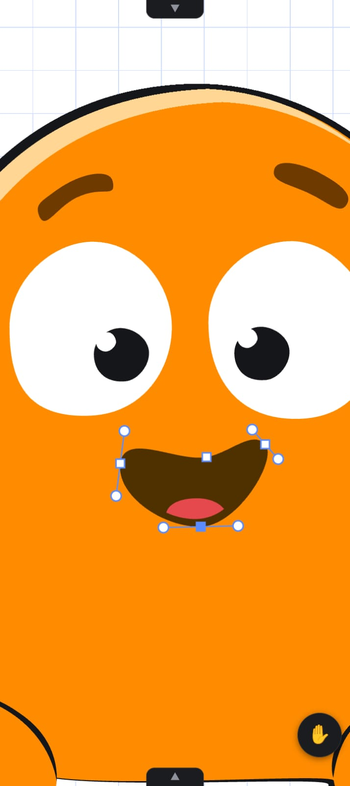
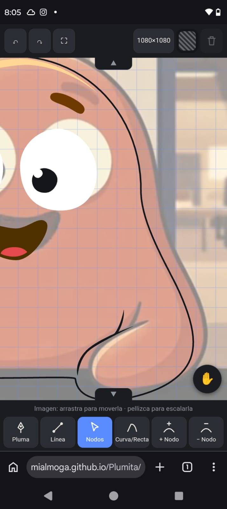
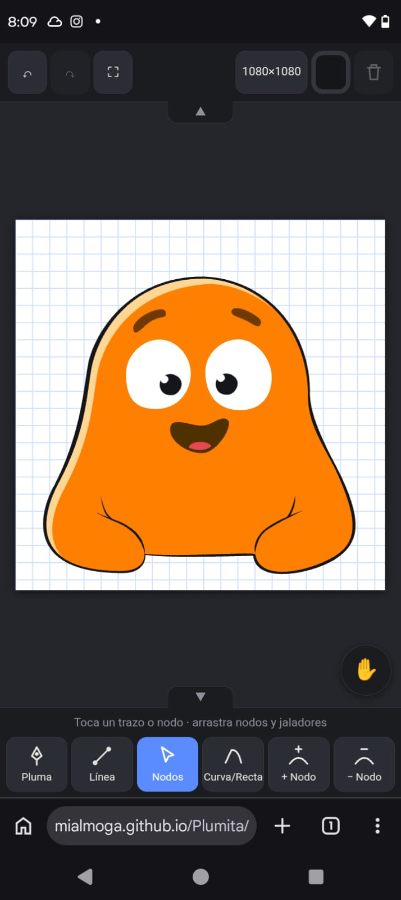
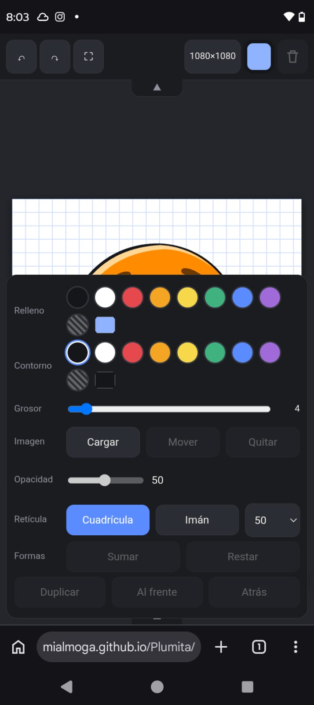
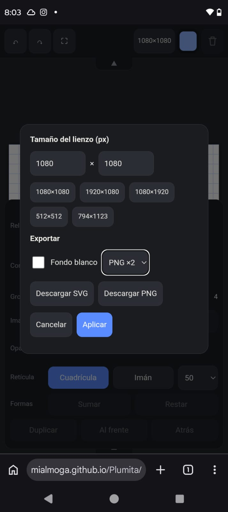
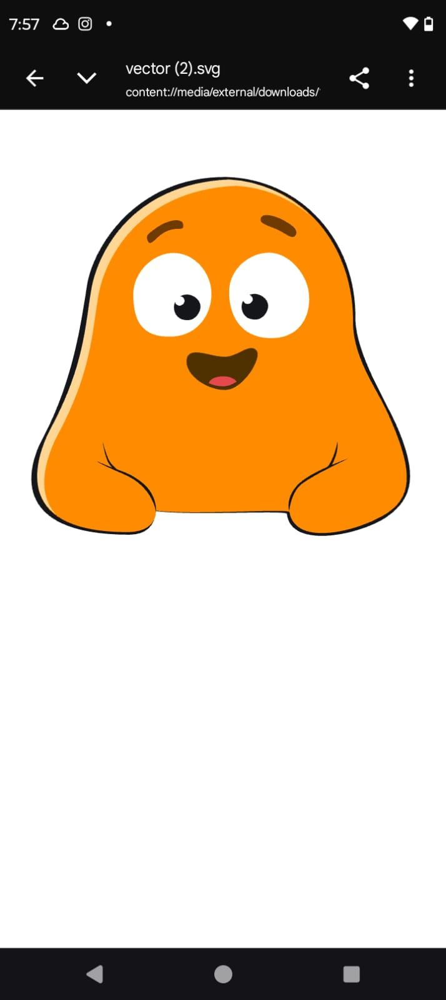
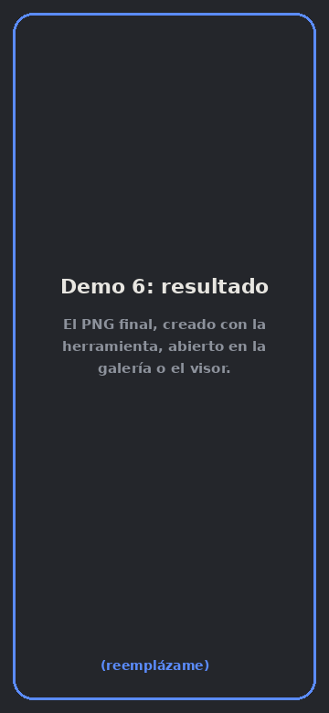
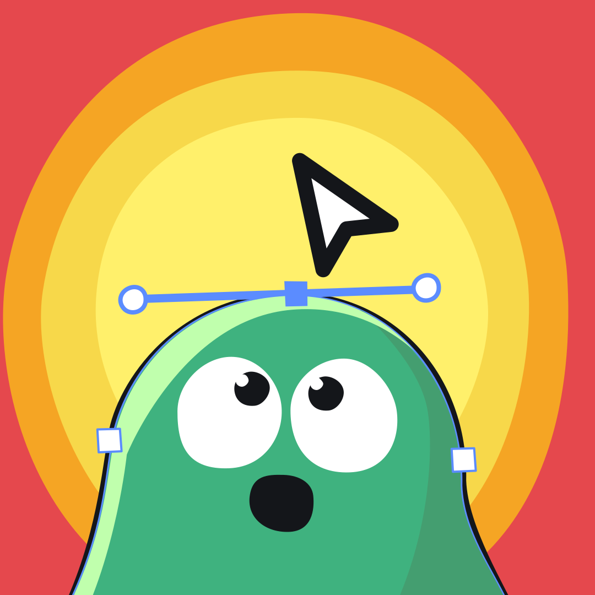

# Plumita

**Editor vectorial de bolsillo.** Pluma, nodos y jaladores, hechos para dibujarse con el pulgar.

Un solo archivo HTML, sin dependencias, sin servidor y sin internet. Lo abres en el navegador del teléfono y dibujas curvas Bézier como en Illustrator, CorelDRAW o FreeHand, pero solo con las herramientas que de verdad se usan.

> *Para quienes dibujan donde no hay escritorio: en el camión, en la fila, en la sala de espera.*
> *Y para toda la gente que alguna vez pensó "ojalá esto existiera en el celular".*

  

- En línea: **<https://mialmoga.github.io/Plumita/>**.

---

## Qué hace

**Dibujo**

- **Pluma:** toca para poner nodos, arrastra para sacar jaladores y curvar, toca el primer nodo para cerrar la forma.
- **Línea:** arrastra y suelta.
- **Nodos:** mueve nodos, estira los jaladores para ajustar la curva, o arrastra el trazo completo.
- **Curva/Recta:** convierte un nodo de punta a suave (y al revés). Si lo arrastras, saca jaladores.
- **+ Nodo / − Nodo:** agrega un nodo sobre el trazo sin cambiar su forma, o quita uno.

**Formas**

- **Sumar y restar** formas cerradas **conservando las curvas** (no las convierte en polígonos). Si restas una forma contenida dentro de otra, queda un hueco.
- Relleno, contorno y grosor, con paleta rápida y selector libre de color.
- Duplicar, llevar al frente, mandar atrás.

**Ayudas para trazar**

- **Imagen de referencia:** carga una foto (por ejemplo, de un dibujo en papel) y trázala a mano. Opacidad ajustable; la mueves y escalas con un dedo y pellizco. No se exporta.
- **Retícula** de 10, 20, 25, 50 o 100 px, con **imán** para que pluma, línea, nodos y jaladores salten a las intersecciones.

<table>
  <tr>
    <td align="center"> Una foto de fondo con opacidad baja, para calcarla a mano</td>
    <td align="center"> Retícula con imán: todo cae en las intersecciones</td>
  </tr>
</table>

**Pensado para móvil**

- Zoom y desplazamiento con dos dedos.
- **Botón mano ✋** para mover el lienzo con un dedo sin cortar el trazo que estás haciendo.
- **Cerrar trazo** con un botón, sin tener que atinarle al primer nodo.
- Si un segundo dedo cae a la mitad de un toque con la pluma, el nodo accidental se descarta solo.
- Pantalla completa y dos pestañitas (arriba y abajo) que pliegan las barras para dar más espacio al lienzo.
- Deshacer y rehacer (hasta 80 pasos).

**Exportar**

- **SVG** y **PNG** (×1, ×2 o ×4), con el tamaño de lienzo que elijas y fondo transparente o blanco.

---

## Cómo usarlo

1. Descarga `index.html`, o en línea: **<https://mialmoga.github.io/Plumita/>**.
3. Ábrelo en el navegador (probado en Chrome para Android).
4. Listo. No hay nada que instalar.

### Guía rápida

| Quiero… | Hago… |
| --- | --- |
| Elegir el tamaño del lienzo | Toca el botón con las medidas (arriba) |
| Exportar | Mismo botón: *Descargar SVG* o *Descargar PNG* |
| Cambiar color, grosor, capas, imagen o retícula | Toca el cuadrito de color (arriba) |
| Sumar o restar | Selecciona una forma cerrada con *Nodos*, abre el panel de color, toca *Sumar* o *Restar* y luego toca la otra forma |
| Mover imagen de referencia | Panel de color → *Mover*, y arrastra o pellizca |
| Navegar sin tocar el dibujo | Botón ✋ (derecha) |
| Ganar espacio | Pestañitas ▲ ▼ y botón ⛶ |

<table>
  <tr>
    <td align="center"> Panel de color y booleanas: sumar y restar conservando las curvas</td>
    <td align="center"> Tamaño del lienzo y exportación a SVG o PNG</td>
  </tr>
</table>

### Del lienzo al archivo

<table>
  <tr>
    <td align="center"> Exportado desde el teléfono</td>
    <td align="center"> El PNG final, hecho con Plumita</td>
    <td align="center"> El SVG final, hecho con Plumita</td>
  </tr>
</table>

---

## Privacidad

Todo ocurre en tu dispositivo. No hay cuentas, red ni analítica. El trabajo se guarda en el `localStorage` del navegador (`vec-doc`, `vec-ref`, `vec-grid`, `vec-ui`), así que sigue ahí si recargas la página. Si la foto de referencia es demasiado pesada para el almacenamiento del navegador, simplemente no se recuerda al recargar, pero tu dibujo vectorial sí.

---

## Cómo funciona por dentro

Todo vive en un solo archivo, organizado por secciones comentadas: geometría, historial, interfaz, dibujo, gestos, estilo, booleanas, referencia y retícula, pantalla completa y pestañas.

- **Modelo:** cada trazo es una lista de nodos `{x, y, i, o, s}`, donde `i` y `o` son los jaladores de entrada y salida (relativos al nodo) y `s` indica si el nodo es suave. Los trazos cerrados pueden llevar `holes`.
- **Render:** SVG puro; el mismo `path` que se ve en pantalla es el que se exporta.
- **Entrada:** Pointer Events, con gestos de uno y dos dedos manejados a mano.
- **Booleanas con curvas:** se buscan las intersecciones entre los segmentos Bézier muestreándolos y afinando con Newton; se corta cada trazo en esos puntos con De Casteljau; cada pedazo se clasifica como dentro o fuera de la otra forma con un test de punto en polígono; y los pedazos que se quedan se vuelven a encadenar en contornos cerrados. Los huecos se pintan con la regla `evenodd`.
- **Imán:** redondea al múltiplo más cercano del tamaño de celda.

---

## Limitaciones conocidas

- Los **huecos** creados al restar se pintan y se exportan bien, pero sus nodos todavía no se pueden editar.
- Las booleanas funcionan sobre formas **cerradas**. Dos formas que comparten un borde exactamente coincidente pueden dar un resultado inesperado.
- No hay degradados, texto, ni panel de capas con nombres.
- La pantalla completa depende del navegador; Safari en iPhone no la permite en páginas web.
- Está probado en Chrome para Android y con pruebas automáticas de la lógica geométrica. En otros navegadores puede haber detalles por pulir.

---

## Créditos

- **Brujo**: idea, dirección de producto, pruebas en el teléfono y todas las observaciones que fueron moldeando la herramienta, como el botón de mano y el de cerrar trazo.
- **Claude (Anthropic)**, modelo Claude Sonnet 5.5: diseño de la arquitectura y escritura del código, en conversación con Brujo.

Se construyó por etapas, probando cada una en un teléfono real antes de seguir con la siguiente.

---

## Licencia

[MIT](LICENSE). Úsalo, cámbialo, mézclalo con lo tuyo y compártelo.
